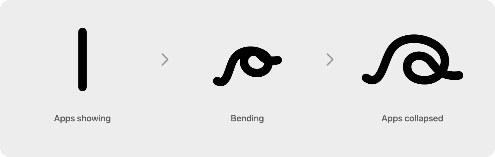

<p align="center">
  <picture>
    <source media="(prefers-color-scheme: dark)" srcset="design/logo/line-apps-lockup-horizontal-reversed.svg">
    
  </picture>
</p>

<h3 align="center">One line for all four.</h3>

<p align="center">A short line in your Mac's menu bar that Tuck's, Pulse's, Hum's and Glow's icons collapse into, and one installer for all four apps.</p>

<p align="center">
  macOS 14 or later · Apple silicon · Free<br>
  <a href="#install">Install</a> · <a href="#the-apps">The apps</a> · <a href="https://lineapps.vercel.app">Website</a>
</p>

<p align="center">
  <picture>
    <source media="(prefers-color-scheme: dark)" srcset="docs/images/bend-dark.png">
    
  </picture>
</p>

## What it does

- **One click.** Click the line and the four apps' icons fade into it, the nearest first, as it bends
  into the Line Apps curl. Click the curl and each comes back where it was. The apps keep working
  while their icons are in the line.
- **The apps, one menu.** Right-click or Control-click the line for Collapse or Show, each app you
  have, Open at Login and Quit. An app opens from there; one already running opens its Settings (Hum
  shows its player), the way in while its icon is in the line.
- **Its own place.** Command-drag the line to put it beside the apps' icons; it keeps that place.
- **No icon out of reach.** Quitting Line Apps brings every icon back, and the line collapses them
  again when it next opens. An app opened while Line Apps is closed shows its icon.
- **One installer.** `Line-Apps-<version>.pkg` puts Line Apps, Tuck, Pulse, Hum and Glow in
  Applications, each the same build as its own download.

Tuck's notch and bubble stay as they are; only its menu-bar icon goes into the line. Opening Line Apps
again shows the note on what the line does, as at first launch.

## Install

Download the installer from [lineapps.vercel.app](https://lineapps.vercel.app). Line Apps comes only
with it; on their own, the apps keep their icons in the menu bar.

1. Open `Line-Apps-<version>.pkg`.
2. The installer isn't signed or notarized yet, so macOS stops it the first time. Choose **Done**, then
   open System Settings › Privacy & Security, choose **Open Anyway** beside the installer's name, then
   **Open Anyway** again and enter your Mac's password. On macOS 14 you can also Control-click the
   installer in Finder and choose **Open**.
3. Follow the installer. To leave any app out, choose **Customize** and untick it. Hum needs macOS 15,
   so on macOS 14 the installer leaves it out.
4. The installer asks for your Mac's password, since the apps go in /Applications. If any of the apps
   is open, it asks to quit it first, so that none is replaced while it runs.
5. When it finishes, Line Apps opens and its line is in the menu bar with a short note. Open the other
   apps from Applications; each asks for what it needs the first time.

Installing over a newer copy of an app keeps the newer one. To remove an app, quit it and move it from
Applications to the Trash.

Each app is also on its own, from its page on the website or with Homebrew:

```sh
brew install --cask millerroberts180/line-apps/tuck
brew install --cask millerroberts180/line-apps/pulse
brew install --cask millerroberts180/line-apps/hum
brew install --cask millerroberts180/line-apps/glow-app
```

Use the full names: Homebrew's own catalogue has other apps by some of these names.

## Private and light

- **Nothing leaves your Mac.** No network code, no analytics and no account. Line Apps keeps two
  settings, whether the apps are collapsed and whether you've seen its note, and macOS keeps the
  line's place in the menu bar.
- **It talks only to the apps.** The line tells them to collapse or come back with a notification that
  stays on your Mac, and each app hides or shows its own icon. Line Apps asks for no permissions.
- **Light.** Nothing runs between clicks: the line is redrawn only while it bends, and each app
  listens with three notification observers, a fourth while collapsed. Swift and AppKit, with no
  package dependencies, in a 1.2 MB app.

## Requirements

- macOS 14 or later, on Apple silicon. Hum needs macOS 15, so on macOS 14 the installer leaves it out.
- No permissions for Line Apps itself. Each app asks for its own the first time it opens.

## Build from source

```sh
scripts/build-app.sh       # builds build/Line Apps.app, universal
open "build/Line Apps.app"
scripts/test.sh            # runs the tests
scripts/build-bundle.sh    # builds the installer from the four apps' repositories
```

You need Swift 6.1 or later; the Command Line Tools are enough. The bundle, the snapshots and how the
apps hear the line are in [docs/development.md](docs/development.md).

## Documentation

- **[Development](docs/development.md):** building the app and the installer, the tests and
  snapshots, and how the apps hear the line
- **[Decision log](docs/decision-log.md):** what was decided, why, and how it was checked

## The apps

Line Apps holds four small Mac apps with one maker and one quiet design, each doing one job:

| App | What it does |
| --- | --- |
| **[Tuck](https://github.com/millerroberts180/tuck)** | Windows, files, links and notes, kept in your Mac's notch |
| **[Pulse](https://github.com/millerroberts180/pulse)** | Feel web pages through your trackpad, and give typing a nicer sound |
| **[Hum](https://github.com/millerroberts180/hum)** | The song you're playing, as album art in a small floating player |
| **[Glow](https://github.com/millerroberts180/glow)** | Brightness, volume and each monitor's own settings, for every display |

The installer puts in all four, with the line. The
[Homebrew tap](https://github.com/millerroberts180/homebrew-line-apps) has each app's cask.

## Licence

Line Apps is free to use, with every feature for everyone. © 2026 Miller Roberts. All rights reserved.
